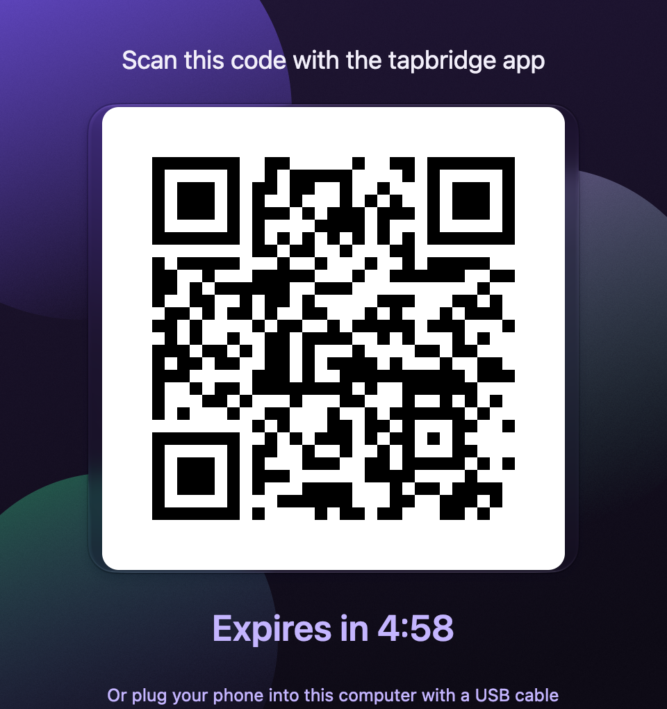
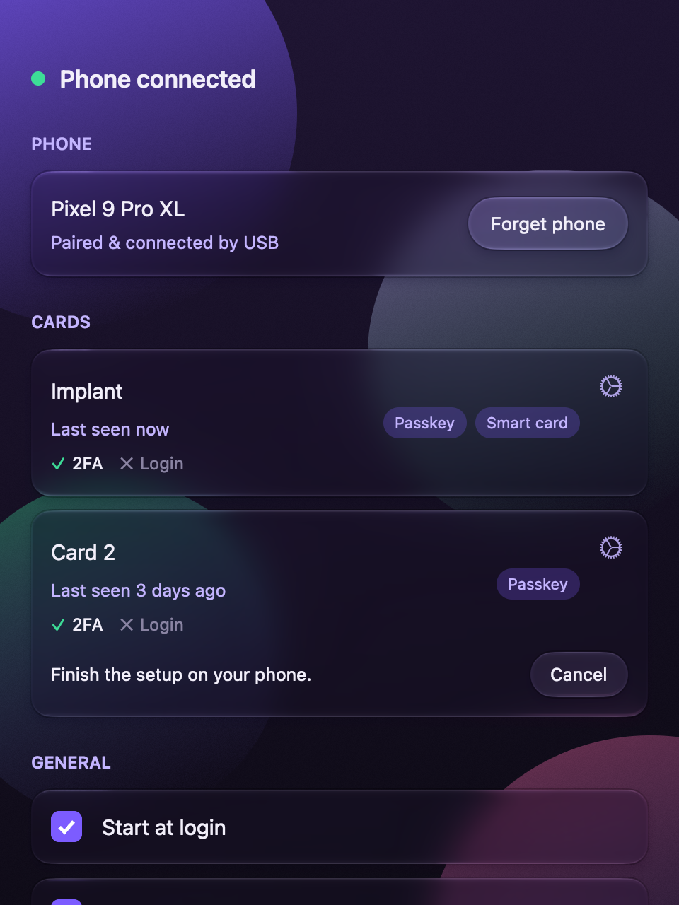
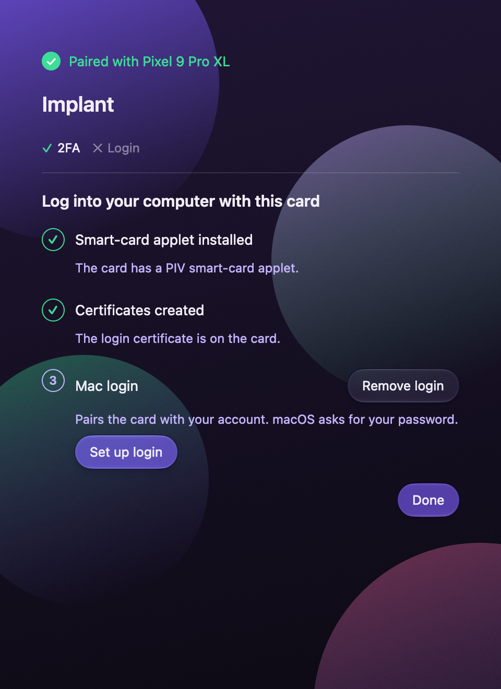

# tapbridge

**Use your phone as the card reader for your computer.**

Some security keys and smart cards come as NFC cards, rings or implants: you use them by tapping them on something. Computers almost never have a place to tap. Phones do.

With tapbridge you tap your card on your Android phone, and your computer acts as if the card were plugged right in. Use it to sign in to websites with a passkey. On a Mac you can even log in to the computer itself with your card, and on Linux `sudo` can ask for a tap instead of your password.

Your card does all the secret work. Your phone and computer only pass messages between each other, over a private, encrypted connection. Nothing stays connected while you aren't using it, so it won't drain your phone's battery.

<p align="center">
  
  
  
</p>

## Features

- **Tap to sign in.** When a website asks for a security key, your phone asks for your card. Hold it to the back of the phone and you're in.
- **Wakes your phone for you.** The phone app doesn't need to be open. Your computer sends a notification when it needs your card.
- **Log in to your Mac with your card.** tapbridge walks you through it step by step: check the card, create its login certificate on your phone, then link it to your Mac account.
- **Your cards stay in sync.** Name a card on your phone or your computer and both know it. Both show what each card can do.
- **Easy pairing.** Scan a code on your computer with your phone. The phone shows when the computer has accepted it, then you tap a card to check that everything works.
- **One phone, many computers.** Pair the same phone with your desktop and your laptop. The phone's home screen lists them all and shows which one it's talking to; tap another to switch.
- **Careful with your card.** tapbridge never replaces certificates already on your card unless you clearly ask it to, and it never guesses your PIN.
- **Mac security settings in one place.** Use your card for `sudo`, `su` and SSH, lock the screen when the card goes away, or turn off passwords entirely.
- **`sudo` with a tap on Linux.** Register a card's security key for `sudo` and `su` from Settings, or let the NixOS module's `pam.sudo` / `pam.su` options set it up.
- **Install the PC app from your phone.** Plug the phone into a Windows PC, turn on USB tethering, and download the installer from the phone in the PC's browser (Settings → Install tapbridge on a PC).
- **Works on macOS, Windows and Linux.** On Linux it's packaged for Nix, with NixOS and Home Manager modules. The phone app is for Android phones with NFC.

## Status

What works today, and on which platforms. macOS and Android last checked by hand in October 2026. Linux runs end to end in a NixOS VM test on every push (a scripted phone answering through the real pcscd reader and the kernel's virtual FIDO key), but hasn't been tried with a real phone yet.

| | macOS | Windows | Linux | Android |
|---|---|---|---|---|
| Passkeys / security keys in the browser, with PIN | ✅ (Safari, incl. Google sign-in) | ❓ not tested in a while | 🧪 virtual FIDO key | ✅ |
| Smart card reader for PIV / OpenSC (PC/SC) | ✅ | ❓ | 🧪 | – |
| Pairing, unpairing, wake-up notifications | ✅ | ❓ | 🧪 | ✅ |
| Create a login certificate on your card (from the phone) | ✅ | – | – | ✅ |
| Log in, unlock and approve prompts with your card (instead of Touch ID) | ✅ | 🔜 | – | – |
| `sudo` / `su` with a tap | 🧪 Mac security settings | – | 🧪 | – |
| Connect over a USB cable | 🧪 new, barely tested | 🧪 | 🧪 | 🧪 |
| Nix modules | 🧪 nix-darwin | – | 🧪 NixOS, Home Manager | – |
| Signed / store builds | 🔜 signed | 🔜 | Nix flake only | 🔜 Play Store |

✅ works · 🧪 built, needs testing · ❓ might work · 🔜 planned · – doesn't apply

**Maybe someday:** an iPhone app, if Apple ever opens up the NFC APIs it would need.

## Development

tapbridge has these parts:

| Part | Where | What it is |
|---|---|---|
| Desktop app | `crates/desktop` | Menu bar / tray app (Rust, gpui) |
| Phone app | `android/`, `crates/phone` | Android app (Kotlin) with a Rust library |
| Shared code | `crates/core`, `crates/host` | Connection, pairing, card records, the host service |
| Wake relay | `relay/` | Small Cloudflare Worker that sends the wake-up push message |

`DESIGN.md` explains how it fits together; `VERIFICATION.md` lists what has been tested.

### Setup (macOS and Linux)

The Nix flake provides everything: Rust, the Android SDK and NDK, JDK 17 and adb.

```sh
nix develop
```

### Common tasks

| What | Command |
|---|---|
| Rust tests | `cargo test --workspace` |
| Lints | `cargo clippy --workspace --all-targets -- -D warnings` |
| Build, install and launch the Mac app | `build-and-run-macos-pkg` (asks for your password to install) |
| Build the Mac installer only | `build-and-run-macos-pkg --no-install` → `dist/tapbridge-<version>-macos.pkg` |
| Desktop windows with sample data | `cargo run -p tapbridge-desktop -- --preview-ui` (set `TAPBRIDGE_PREVIEW_DIALOG` to `new`, `paired` or `about` for other screens) |
| README screenshots (`docs/screenshots/`) | `scripts/screenshots.sh` |
| Linux package, and the NixOS VM test | `nix build .#tapbridge`, `nix build .#checks.x86_64-linux.vm -L` |
| Android tests and debug APK | `build-android testDebugUnitTest assembleDebug` |
| Install the APK on a phone | `adb install -r android/app/build/outputs/apk/debug/app-debug.apk` |
| Play bundle (AAB) | in `android/`: `./gradlew bundleRelease` |

### nix-darwin

You can install tapbridge and set all its options from your nix-darwin config instead of using the installer: see [docs/nix-darwin.md](docs/nix-darwin.md). `nix build .#tapbridge` builds the app on its own.

### Linux

tapbridge gives a Linux PC a PC/SC reader (PIV, OpenSC) and a virtual FIDO security key (WebAuthn, passkeys), both backed by the card on your phone. NixOS and Home Manager modules set it all up: see [docs/nixos.md](docs/nixos.md) and [docs/home-manager.md](docs/home-manager.md). `nix build .#tapbridge` builds the app on its own.

### Windows

You need Rust 1.91+, LLVM clang, the MSVC build tools (x64 and arm64 libraries) and Inno Setup 6.

| What | Command |
|---|---|
| Tests, lints, formatting | `powershell -File scripts\check.ps1` |
| Installers (into `dist\`) | `$env:TAPBRIDGE_RELAY_URL='https://...'; powershell -File scripts\build-desktop.ps1 -Arch both` |

`tapbridge.exe --trace-apdu` logs one line per card command (command name and status only, never card data).

### Secrets and signing

- Wake-up notifications need `android/app/google-services.json` (Firebase). It is not in the repository. Debug builds fall back to a placeholder, so wake-ups won't work; release builds fail without it.
- Android release signing reads `TAPBRIDGE_UPLOAD_*` from `~/.gradle/gradle.properties`.
- To sign the Mac installer, pass `--sign "Developer ID Installer: NAME (TEAMID)"` to the build.
- To deploy the wake relay, see `relay/README.md`.

### CI

`.github/workflows/build.yml` runs on every push: tests and clippy on each platform, the Mac installer, the Windows installers (x64 and arm64), the Android APK, the Linux Nix package with its NixOS VM test, and a check that the generated Nix option docs are up to date.
